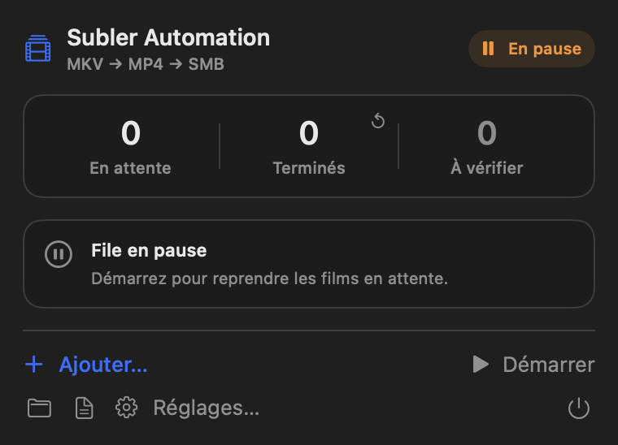
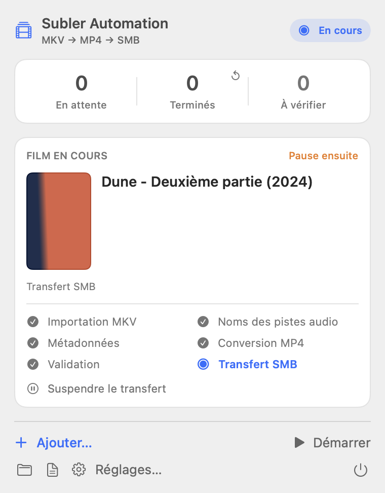

# Subler Automation

**Vos MKV → des MP4 identifiés et vérifiés → votre serveur SMB.**

Une application native pour macOS qui pilote [Subler](https://subler.org/) et traite vos films un par un. Utilisez-la dans la barre des menus ou dans une fenêtre avec une icône dans le Dock.

## Aperçu

| File en pause · thème sombre | Film en cours · thème clair |
| :---: | :---: |
|  |  |

*Captures des vraies vues de l’application, avec des données de démonstration et une affiche fictive. Aucun film personnel n’est utilisé.*

## Ce que fait l’application

- Surveille un dossier de MKV, ou accepte des films ajoutés manuellement.
- Utilise Subler pour les métadonnées et la conversion en MP4, en conservant ses préférences.
- Demande votre confirmation si le titre ou l’année sont ambigus.
- Vérifie le MP4, puis le copie sur le serveur avec suivi du transfert et contrôle d’intégrité.
- Classe les films sous `Titre (Année)/Titre (Année).mp4`.
- Conserve la file après redémarrage et permet de réessayer les tâches en erreur.

## Installation

Prérequis : **macOS 14+**, les outils Swift/Xcode, **Subler** (version testée : 1.9.5) et **ffprobe** (`brew install ffmpeg`). La conversion est réalisée par Subler, pas par FFmpeg.

Depuis le dossier du projet :

```sh
./build.sh
open "dist/Subler Automation.app"
```

Le bundle est signé ad hoc, sans notarisation. macOS peut demander les autorisations à nouveau après une recompilation.

## Démarrer en 3 étapes

1. Dans **Réglages → Autorisations**, préparez le contrôle de Subler et l’accès aux dossiers.
2. Dans **Dossiers** et **Serveur**, choisissez la source, le cache temporaire et votre partage SMB. Le stockage local est conseillé, mais les emplacements réseau montés sont autorisés.
3. Déposez vos MKV dans `~/Movies/Subler Automation/À convertir/`, ou cliquez sur **Ajouter…**, puis **Démarrer**.

Sans serveur configuré, les MP4 validés restent dans le dossier temporaire en attendant le transfert. Pour une copie longue, utilisez une extension `.part`, puis renommez en `.mkv` lorsque la copie est terminée.

## Vos fichiers restent protégés

- Les MKV originaux ne sont jamais supprimés.
- Aucun doublon n’est remplacé sans confirmation ; un remplacement conserve une sauvegarde.
- Le nettoyage des MP4 temporaires est désactivé par défaut.
- L’authentification SMB est gérée par macOS ; l’application ne stocke aucun mot de passe.
- Évitez les opérations manuelles simultanées dans la file partagée de Subler.

## Pour aller plus loin

[Guide technique et dépannage](docs/guide-technique.md) · [Résultats des tests](TEST-RESULTS.md)

Développement : `swift test`. Captures de démonstration isolées : `python3 scripts/render-ui.py`.
